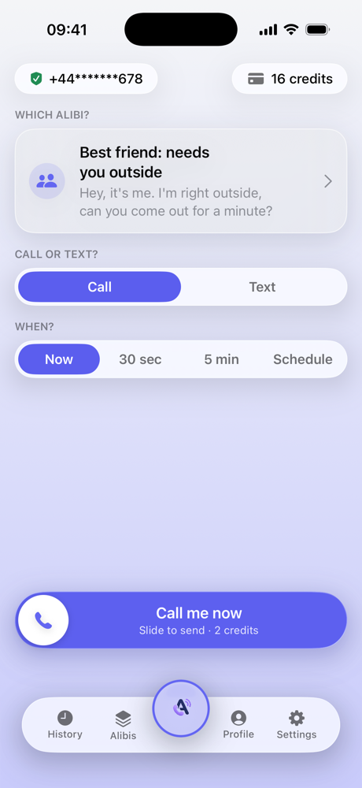
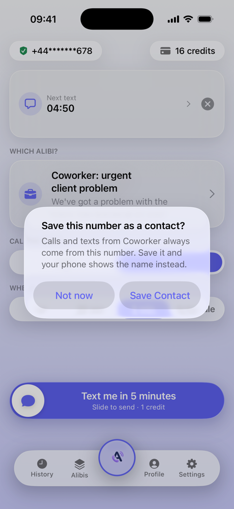
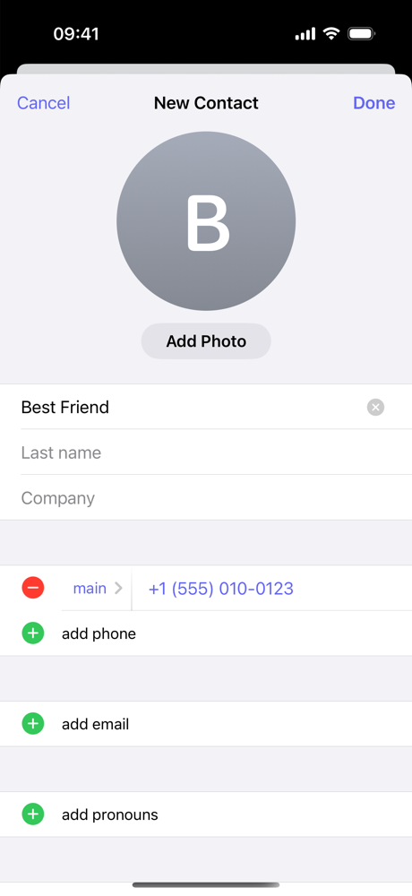
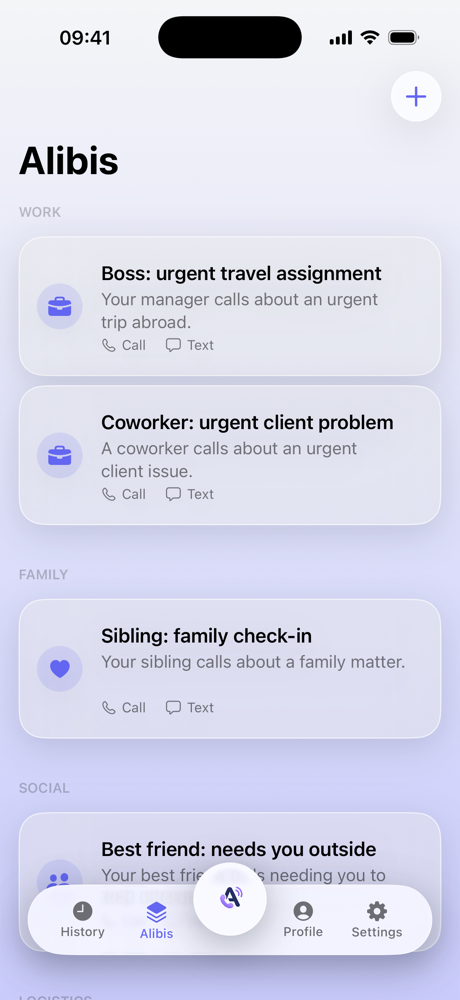
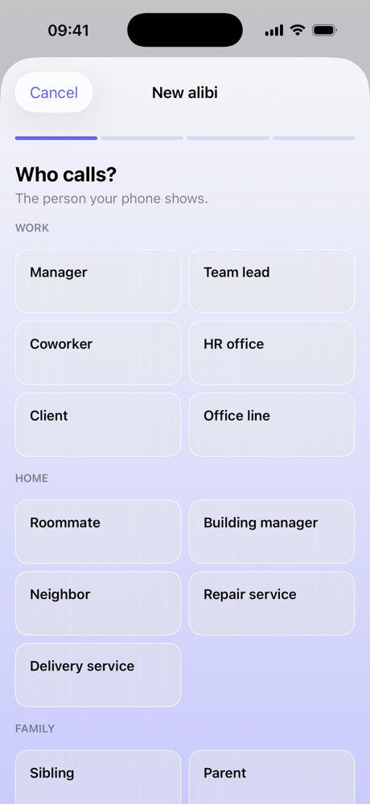
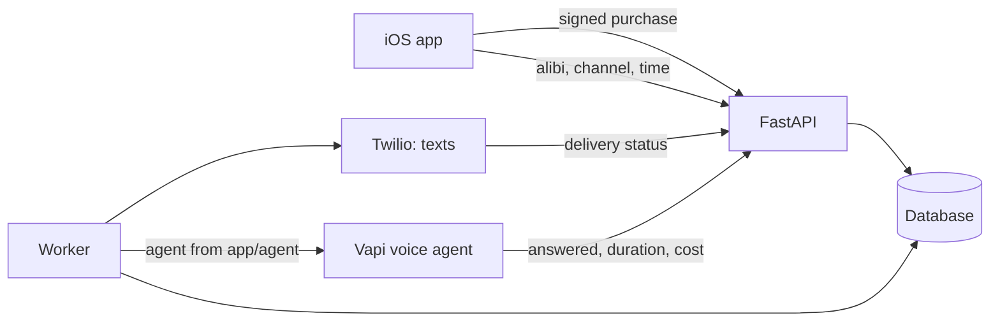

# AlibiMe

AlibiMe is an iOS app that calls you when you need a reason to leave. The
caller is an AI voice agent. You choose who it should be, say your best friend
or your roommate, and why they are calling, and the agent phones you and plays
the part in a short, natural conversation. Texts work too and always come from
the same number, so you can save it as "Mom" and the next one looks real.

You pick an alibi on Home, choose call or text and when, and slide to send.
The app, the calls and the texts come in English and German.

<p align="center">
  
  &nbsp;
  
  &nbsp;
  
</p>

## The AI part

Calls run on [Vapi](https://vapi.ai), which handles speech recognition, the
language model and the voice. The agent itself lives in this repo, in
`backend/app/agent`: its prompt, model, voice and transcriber go to Vapi with
every call, so nothing is configured by hand in a dashboard and every change to
the agent is a code change with tests.

The prompt is written for a private call between people who know each other.
The caller never introduces themselves, since the saved contact already shows
who it is, keeps sentences short, avoids anything that sounds like customer
service, gets their ask across and hangs up. Background noise is off, so it
doesn't sound like an office. For every call the backend fills in who is
calling and why, how urgent it is, the tone, the user's local time, which facts
the caller may mention and which it must not, and roughly how many turns to
take. The facts come from the optional Profile (work, home, family and so
on, each picked from a list), and the user decides how much of it a caller may
use.

`backend/evals` tests the agent. It talks to the same prompt the real calls
use, with a scripted person on the other end who asks who's calling, whether
this is a bot, what exactly happened, or says they're busy. Rule checks catch
service phrases, self-introductions, admitting to be an AI, forbidden topics
and turns that run too long, and an optional LLM judge scores how natural the
call sounds. It runs offline with a mock model in the test suite, or against
OpenAI or Anthropic with a key.

Nothing a user types ever reaches the model. The optional first name a caller
may say is picked from a fixed list of about 1,500 names, the Profile is picked
from lists, and even their own alibis are put together from fixed options, with
the backend composing the wording from approved building blocks. The agent can
only ever call the number the user verified at sign-up, so it can't be turned
into a tool for calling or misleading someone else. Calls are not recorded, and
neither the backend nor Vapi keeps a transcript.

<p align="center">
  
  &nbsp;
  
</p>

## How it's built

The backend is Python with FastAPI, SQLAlchemy and Alembic, the app is SwiftUI.
Texts and sign-in codes go through Twilio. A worker sends requests when they
are due and drops any that are more than ten minutes late, without charging,
since a call that late no longer helps. Phone numbers are stored encrypted and
never logged.

Each persona calls and texts from the same number, so once the user saves it as
a contact, both show up under that name. The Action Button (or Siri with "Get
me out with AlibiMe", or a Shortcut) can send a preset alibi without opening
the app. Credits are bought as App Store in-app purchases, and the backend
checks Apple's signed transaction before granting them. New numbers get free
credits for one text and one call, the first purchase comes with a bonus, and
accounts can be deleted from Settings, which also links the help and privacy
pages the API serves in both languages. How the prices were worked out is in
[`docs/pricing.md`](docs/pricing.md). Free credits go once per phone number and
once per iPhone (Apple's DeviceCheck), not to virtual numbers, and the server
refuses to start while any provider is still a mock. Running it on a server,
and everything still open before launch, is in [`deploy/`](deploy/).



There are 249 backend tests, including the evals, and 168 iOS unit tests.

## Running it locally

```bash
cd backend
make bootstrap   # set up venv, database and seed data
make api         # http://127.0.0.1:8000
make worker      # second terminal
make eval        # agent evals, offline
```

Then open `frontend/App/BelievableCall.xcodeproj` in Xcode and run it on a
simulator. With the mock providers the sign-in code is always `123456`, and
purchases go through a mock store so nothing is charged.
Every text a user sees needs its German translation in the same change;
[`CLAUDE.md`](CLAUDE.md) explains how, and `frontend/scripts/strings.sh --check`
checks it. BelievableCall was the working title and is still the name of the Xcode
project.

More detail is in [`docs/DOCUMENTATION.md`](docs/DOCUMENTATION.md) and the
specs in [`docs/specs/`](docs/specs/).
