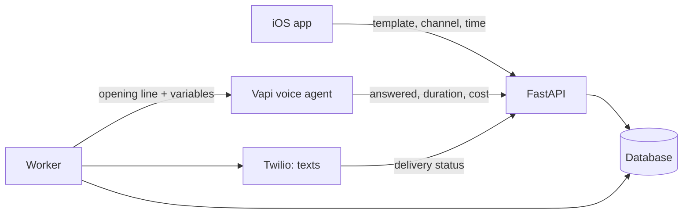

# AlibiMe

AlibiMe is an iOS app that calls you when you need a reason to leave. The
caller is an AI voice agent. You choose who it should be, say your best friend
or your roommate, and why they are calling, and the agent phones you and plays
the part in a short, natural conversation. Texts work too and always come from
the same number, so you can save it as "Mom" and the next one looks real.

<p align="center">
  
  &nbsp;
  
  &nbsp;
  
</p>

## The AI part

Calls run on a voice agent at [Vapi](https://vapi.ai), which handles speech
recognition, the language model and the voice. The backend decides what the
agent knows. For every call it builds the opening line and a set of variables
from the chosen template: who is calling and why, how urgent it is, the tone,
the user's local time, which facts the caller may mention if asked and which it
must not, and roughly how many turns the conversation should take. The agent's
prompt works only with these values, and the call has a hard time limit.

Nothing a user types ever reaches the model. Even custom templates are put
together from fixed options, and the backend composes the wording from approved
building blocks. That rules out prompt injection and means the agent can't be
turned into a tool for calling or misleading someone else. It can only ever
call the number the user verified at sign-up.

When the call ends, Vapi reports back through a webhook whether it was
answered, how long it lasted and what it cost, and the backend closes the
request. The voice provider sits behind an interface with a mock next to it,
so it can be swapped, and the whole app runs locally without an account.

<p align="center">
  
  &nbsp;
  
</p>

## How it's built

The backend is Python with FastAPI, SQLAlchemy and Alembic, the app is SwiftUI.
Texts and sign-in codes go through Twilio. A worker sends requests when they
are due, and phone numbers are stored encrypted and never logged.



There are 74 backend tests and 105 iOS unit tests.

## Running it locally

```bash
cd backend
make bootstrap   # set up venv, database and seed data
make api         # http://127.0.0.1:8000
make worker      # second terminal
```

Then open `frontend/App/BelievableCall.xcodeproj` in Xcode and run it on a
simulator. With the mock providers the sign-in code is always `123456`.
BelievableCall was the working title and is still the name of the Xcode
project.

More detail is in [`docs/DOCUMENTATION.md`](docs/DOCUMENTATION.md) and the
specs in [`docs/specs/`](docs/specs/).
