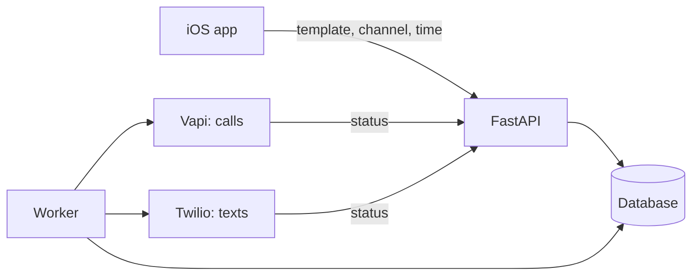

# AlibiMe

AlibiMe is an iOS app that calls or texts you when you need a reason to leave.
You choose who it should come from, say your best friend or your roommate, and
when it should arrive. An AI voice agent then makes the call and plays the
part, or a text shows up.

Texts from the same person always come from the same number, and the app
offers to save it as a contact. Next time your phone shows "Mom" instead of an
unknown number, which is what makes it believable.

<p align="center">
  
  &nbsp;
  
  &nbsp;
  
</p>

## Safeguards

The app can only reach the number you verified when signing up. A request does
not even have a field for another number. Your own templates are put together
from fixed options instead of free text, so nobody can use it to send a message
they wrote to someone else. Calls have a time limit, and phone numbers are
stored encrypted and never logged.

<p align="center">
  
  &nbsp;
  
</p>

## How it's built

The backend is Python with FastAPI, SQLAlchemy and Alembic, the app is SwiftUI.
Calls go through Vapi, texts and sign-in codes through Twilio. Each provider
sits behind its own interface with a mock next to it, so the whole thing runs
locally without any accounts. A worker sends due requests, and the providers
report back through webhooks whether a call was answered or a text delivered.



There are 74 backend tests and 105 iOS unit tests.

## Running it locally

```bash
cd backend
make bootstrap   # set up venv, database and seed data
make api         # http://127.0.0.1:8000
make worker      # second terminal
```

Then open `frontend/App/BelievableCall.xcodeproj` in Xcode and run it on a
simulator. With the mock providers the sign-in code is always `123456`.
BelievableCall was the working title and is still the name of the Xcode
project.

More detail is in [`docs/DOCUMENTATION.md`](docs/DOCUMENTATION.md) and the
specs in [`docs/specs/`](docs/specs/).
