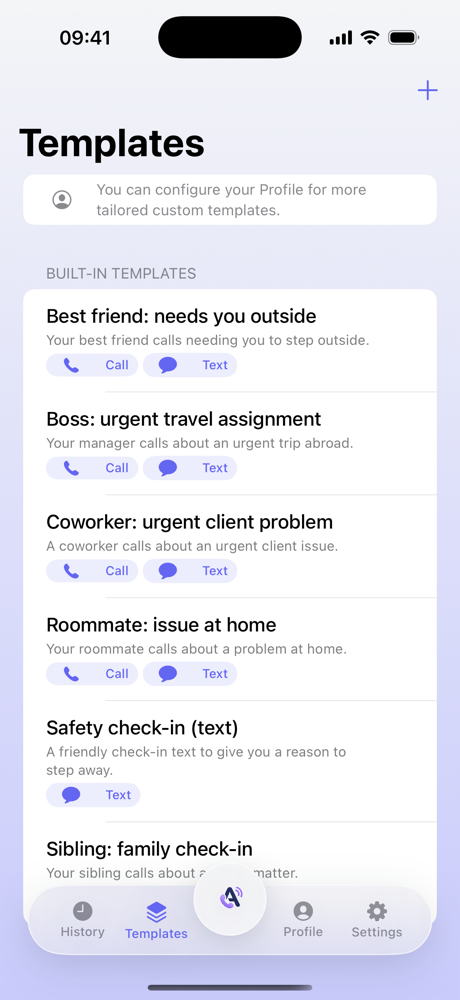
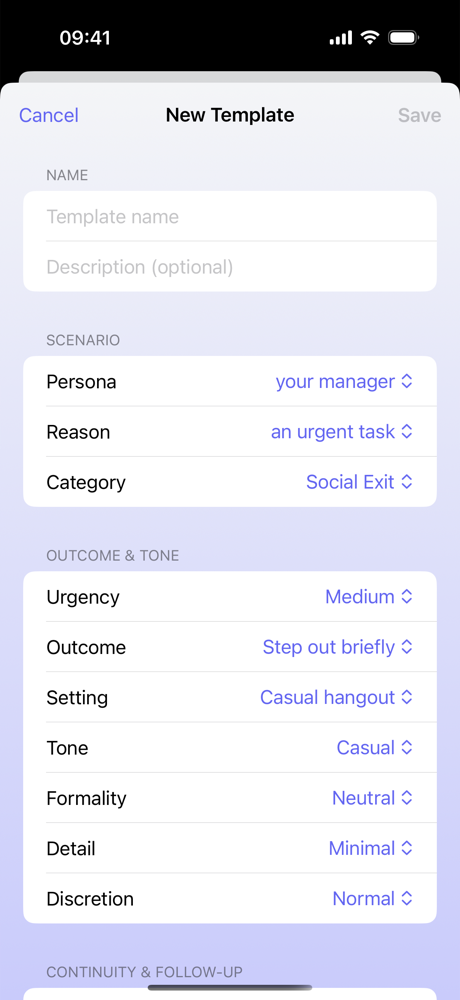
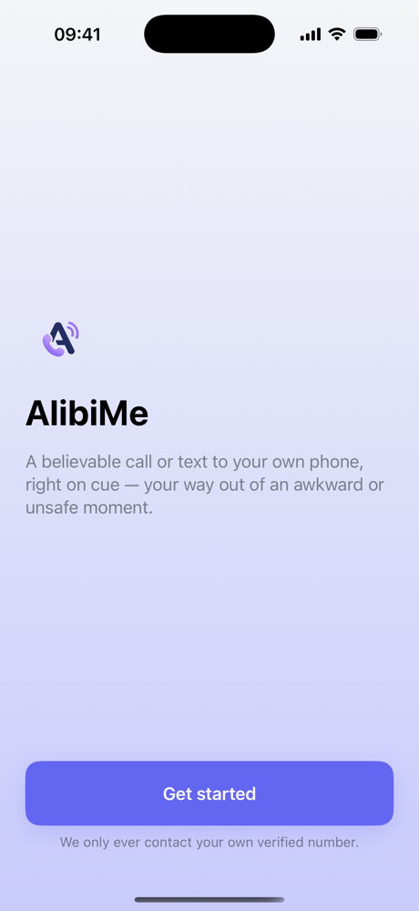
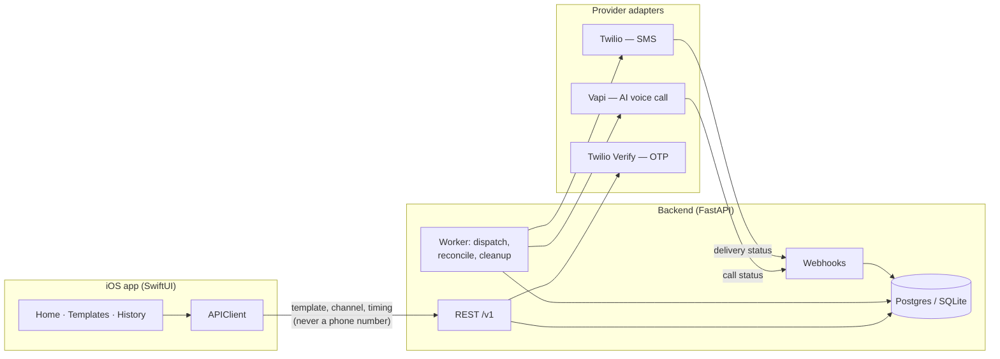

# AlibiMe

**Your way out — a believable call or text, right on cue.**

Stuck on a bad date, cornered at a party, walking home and something feels off?
AlibiMe makes your phone ring with a realistic call or text, so you have a
reason to step away without having to explain yourself. You pick who is
calling and when; the call or text arrives on **your own phone**, and you take
it from there.

<p align="center">
  
  &nbsp;
  
  &nbsp;
  
</p>

---

## When it helps

- **An uncomfortable date or meeting** — your best friend "needs you outside".
- **Getting out of a situation that feels unsafe** — a call from someone you
  know gives you an immediate, unremarkable reason to leave.
- **A conversation that won't end** — an urgent call from work, handled.
- **Walking home late** — a safety check-in text that you can answer on cue.

## How it works

1. **Pick a template** — *Best friend: needs you outside*, *Roommate: issue at
   home*, *Coworker: urgent client problem*, a *Safety check-in*, or build your
   own.
2. **Choose call or text.**
3. **Choose timing** — now, in 30 seconds, in 5 minutes, or at a set time.
4. **Your phone rings.** A short, in-character voice call (or a text) that
   sounds like the real thing and ends naturally.

### "It's Mom calling"

A call from an unknown number is easy to dismiss. A call from **Mom** is not.

Each persona keeps a **stable sender number**: texts from "Best Friend" always
come from the same line. After the first one, AlibiMe offers to save that
sender as a contact, prefilled with name and number. From then on your alibi
shows up on the lock screen as someone you know — which is exactly what makes
it work when you need to leave *now*.

---

## Built to be safe by design

An app that places convincing calls has to be hard to misuse. The guardrails
live in the architecture, not in a terms-of-service page:

- **Own number only.** A request never carries a destination number. The
  backend always delivers to the user's verified phone; the request schemas
  reject unknown fields (`extra="forbid"`), and tests on both sides assert there
  is no destination field anywhere in the flow.
- **No free-form content.** Custom templates are built from structured choices
  (persona × reason × urgency × tone × channels). The backend composes the
  wording from approved building blocks; there is no text box that could be
  turned into a harassment or impersonation script.
- **Bounded calls.** The AI voice agent runs with a capped duration and a fixed
  opening line from the template.
- **Phones encrypted at rest**, masked in every response, never logged.
- **One active request per user** and a per-hour rate limit.

<p align="center">
  
  &nbsp;
  
  &nbsp;
  
</p>

---

## Architecture



**A request's life:** the app posts *template + channel + timing*. The backend
checks idempotency, the one-active-request rule and credits, resolves the
user's own verified number, and stores the request as `scheduled`. A worker
loop claims due requests (`FOR UPDATE SKIP LOCKED` on Postgres, so several
workers never double-dispatch), builds a provider-neutral plan and hands it to
Vapi or Twilio. Provider webhooks then move the request to `completed`,
`no_answer` or `failed`; a reconciliation pass fails anything stuck and
releases its credit.

### Engineering highlights

- **Ports and adapters.** Voice, SMS and OTP each sit behind a neutral
  interface with a real and a mock implementation. The whole
  app — including the iOS client — runs end to end with **zero external
  accounts**.
- **One status authority.** Request lifecycle logic lives in one module and is
  shared by the dispatcher and the webhooks.
- **Credits as a ledger.** Reserve at dispatch, capture on acceptance, release
  on failure; the balance is a sum over entries, never a mutable field.
- **Two locales.** Templates ship in English and German.
- **iOS client.** SwiftUI with `@Observable` view models, a single networking
  owner, Keychain session storage and **Liquid Glass** styling on iOS 26. The
  package also compiles for macOS so logic and view-model tests run on the host.
- **Tests:** 74 backend tests (unit, integration, contract) and 105 iOS unit
  tests.

| | Stack |
|---|---|
| **`backend/`** | Python 3.11 · FastAPI · SQLAlchemy 2 · Alembic · SQLite locally, Postgres in production · Vapi · Twilio |
| **`frontend/`** | Swift · SwiftUI · SwiftPM library + thin app target · iOS 17+ |

---

## Running it locally

**Backend** with mock providers (no Twilio or Vapi account needed):

```bash
cd backend
make bootstrap   # venv, dependencies, .env, migrations, seed data
make api         # http://127.0.0.1:8000
make worker      # in a second terminal: dispatches scheduled requests
```

In mock mode the OTP code is always `123456`, and new accounts start with a few
free credits. See [`backend/README.md`](backend/README.md) for real Twilio and
Vapi setup.

**iOS app:**

```bash
cd frontend
open App/BelievableCall.xcodeproj   # run on a simulator
```

To use a different backend URL, set `BC_BACKEND_URL` in the scheme's
environment. See [`frontend/README.md`](frontend/README.md).

> `BelievableCall` is the project's original codename; it survives in module and
> target names.

## Documentation

- [`docs/DOCUMENTATION.md`](docs/DOCUMENTATION.md) — developer guide:
  architecture, request lifecycle, invariants, with code references.
- [`docs/specs/`](docs/specs/) — the product and feature specs the app was
  built from.
- [`backend/README.md`](backend/README.md) · [`frontend/README.md`](frontend/README.md)
  — setup and testing for each half.

## Responsible use

AlibiMe only ever calls or texts **your own** verified number. Use it to get
yourself out of a moment, not to mislead anyone in a way that matters, and never
where a real call is required (emergencies, official or legal obligations). If
you are in danger, call your local emergency number.
