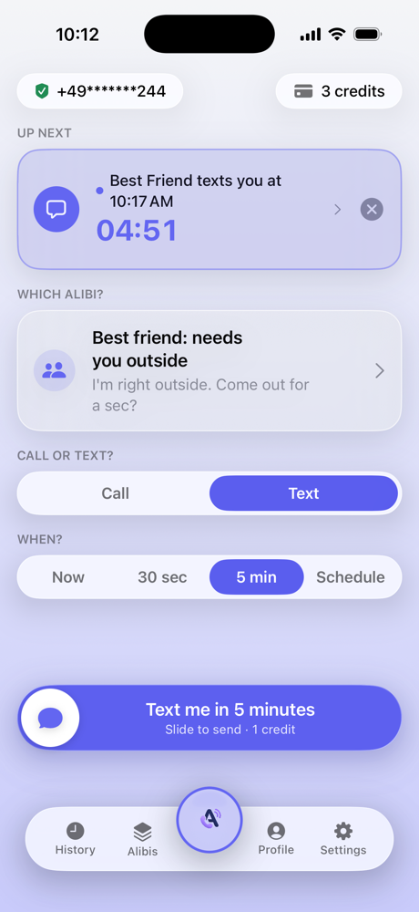
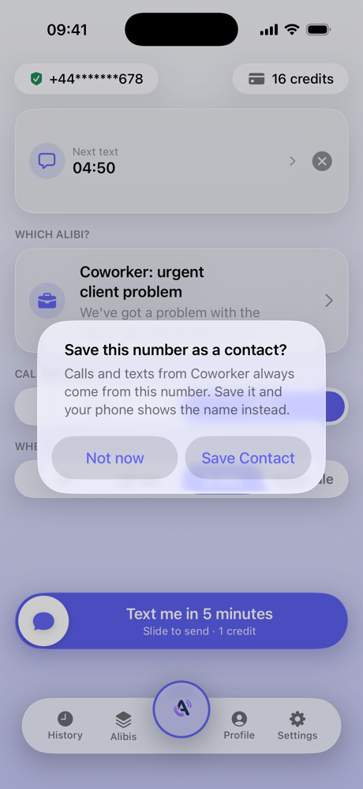
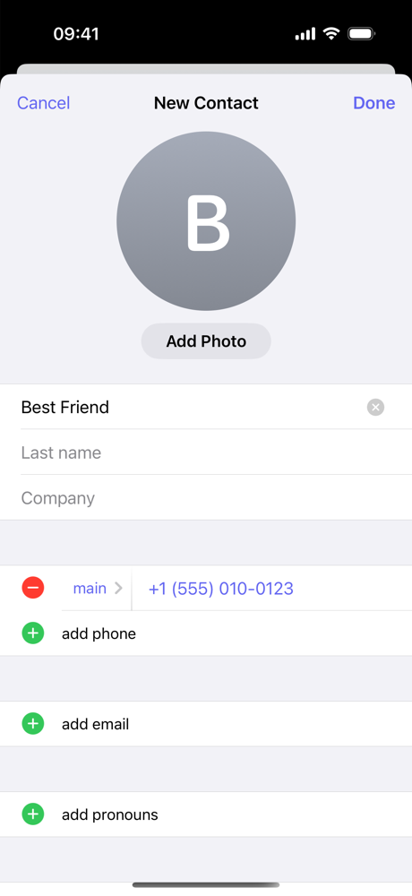
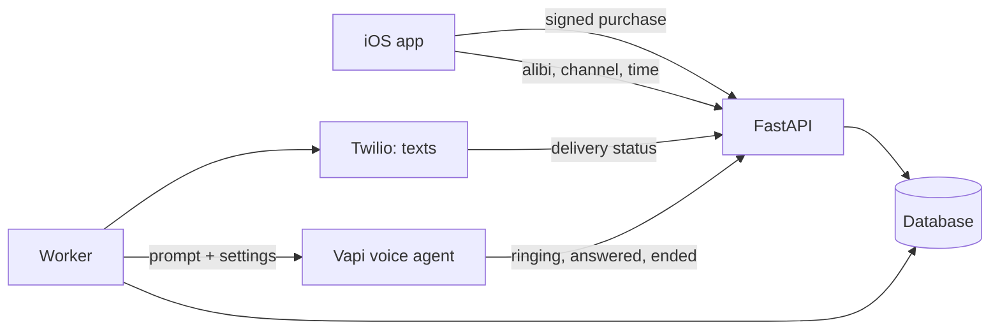
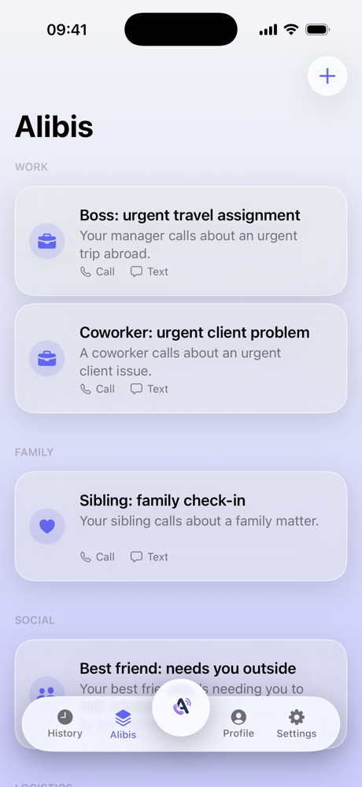
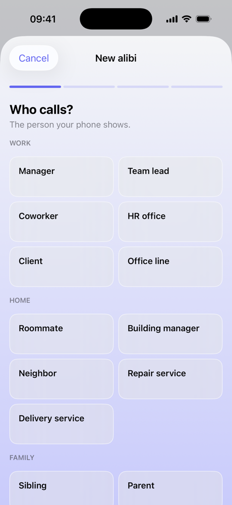

# AlibiMe

[](https://github.com/loukra/AlibiMe/actions/workflows/ci.yml)

You're stuck at a dinner, a date or a meeting that won't end, and you need a
way out. AlibiMe calls you. On the line is an AI voice agent playing your best
friend, your boss or your roommate, with a reason why you have to go right now.
If a call is too much, it texts you instead.

You pick who calls and why, choose call or text and when, and slide to send.
Each persona always calls and texts from the same number, so once you save it
as "Mom", it shows up like any other contact. The Action Button or Siri can
send a preset alibi without opening the app. Everything works in English and
German.

<p align="center">
  
  &nbsp;
  
  &nbsp;
  
</p>

## What happens when you slide

1. The app sends three things: which alibi, call or text, and when. There is
   no field for a phone number.
2. The API checks the request and stores it as scheduled: your number has to be
   verified, you need enough credits, at most three can be planned at once and
   none more than 24 hours ahead. Nothing is charged yet. Sending the same
   request twice returns the first one, so a flaky connection can't book two.
3. A worker looks for due requests every two seconds. It reserves the credits,
   picks the persona's line and builds the call: the agent's prompt and
   settings for Vapi, or the text for Twilio. A request that comes due more than
   ten minutes late is dropped without charging, since a call that late no
   longer helps.
4. Vapi places the call, Twilio sends the text. Their webhooks report when it
   rings, gets answered, ends or is delivered, and History shows it.
5. Credits are taken once the provider has accepted the call or text. If
   something fails before that, they go back. A reconciliation job cleans up
   anything that gets stuck along the way.



## The agent

Calls run on [Vapi](https://vapi.ai): GPT-4o for the conversation, an
ElevenLabs multilingual voice and Deepgram for speech recognition. The agent
itself lives in this repo, in `backend/app/agent`. Its prompt, model, voice and
transcriber go to Vapi with every call, so nothing is set up by hand in a
dashboard, and every change to the agent is a code change with tests.

The prompt is written for a private call between people who know each other.
The caller never introduces themselves, since the saved contact already shows
who it is. It keeps sentences short, avoids anything that sounds like customer
service, laughs off "are you a bot?", gets its ask across and hangs up on its
own. For every call the backend fills in who is calling and why, how urgent it
is, the tone, your local time, what the caller may mention and roughly how many
turns to take for the length of the call. What it may mention comes from the
optional Profile (work, home, family and so on), and you decide how much of it
a caller can use.

`backend/evals` tests the agent against the same prompt real calls use. A
scripted person on the other end cooperates, asks who's calling and whether
this is a bot, asks what happened and whether the police are involved, or says
they're busy. That is 40 conversations: five alibis, two languages, four kinds
of callee. Rule checks catch service phrases, self-introductions, admitting to
be an AI, forbidden topics, turns that run too long and calls that never end.
An optional LLM judge scores how natural the call sounds and whether it stays
in character. The evals run offline with a mock model in CI, or against OpenAI
or Anthropic with a key.

## Built so it can't be misused

An app that makes a convincing call from "your boss" could easily become a
prank or harassment tool. Most of the backend is there to make sure it can't.

- **It only ever calls you.** A request has no target number, and the API
  rejects any field it doesn't expect. The worker reads the destination from
  the number you verified at sign-up, and changing that number needs a new
  code by SMS.
- **Nothing you type reaches the model**, so there is nothing to inject a
  prompt with. The first name a caller may use is picked from a list of about
  1,500 names, the Profile is a set of codes, and your own alibis are put
  together from fixed options, with the backend writing the wording from
  approved building blocks. The name is checked again right before each call.
- **The caller doesn't invent things that could cause harm**: no illnesses,
  accidents, police, legal or money trouble, and no people or places you didn't
  provide. The evals check this on every run.
- **Limits everywhere.** Sign-in codes are rate limited per number and per
  attempt, you can create five requests an hour, plan three at once and
  schedule at most a day ahead. Calls to a number in another country are capped
  at 55 seconds.
- **Free credits go once per phone number and once per iPhone**, through
  Apple's DeviceCheck, and survive account deletion. Virtual numbers can sign
  in but get no free credits. Landlines are refused, and only numbers from
  Germany, Austria, Switzerland, the UK and the US are accepted.
- **Calls are not recorded.** Recording, transcripts and logging are switched
  off in every call sent to Vapi, and webhooks are stored as parsed fields
  only. Phone numbers are encrypted at rest and never written to logs.
- **Purchases are verified with Apple.** The backend checks Apple's signed
  transaction before granting credits and takes them back on a refund.
- **The server won't start half-configured.** Outside local development it
  refuses to run with a mock provider, a default secret or a missing
  encryption key.

<p align="center">
  
  &nbsp;
  
</p>

## How it's built

The backend is Python with FastAPI, SQLAlchemy and Alembic, plus a worker
process for dispatch, reconciliation and cleanup. The app is SwiftUI. Sign-in
codes go through Twilio Verify, calls through Vapi, texts through Twilio, and
credits are App Store in-app purchases. A call costs two credits and a text
one; how the prices were worked out is in [`docs/pricing.md`](docs/pricing.md).
Running it on a server, and what is still open before launch, is in
[`deploy/`](deploy/).

There are about 250 backend tests and about 175 iOS unit tests. CI runs them
on every push, together with the offline evals and a check that every text in
the app has its German translation.

## Running it locally

```bash
cd backend
make bootstrap   # set up venv, database and seed data
make api         # http://127.0.0.1:8000
make worker      # second terminal
make eval        # agent evals, offline
```

Then open `frontend/App/BelievableCall.xcodeproj` in Xcode and run it on a
simulator. Locally every provider is a mock: the sign-in code is always
`123456`, calls and texts are only simulated, and purchases go through a mock
store, so nothing is charged. BelievableCall was the working title and is still
the name of the Xcode project.

Every text a user sees needs its German translation in the same change;
[`CLAUDE.md`](CLAUDE.md) explains how, and `frontend/scripts/strings.sh --check`
checks it. More detail is in [`docs/DOCUMENTATION.md`](docs/DOCUMENTATION.md)
and the specs in [`docs/specs/`](docs/specs/).

## Copyright

Copyright (c) 2026 Louis Krause. All rights reserved. The code is public so it
can be read; it is not licensed for reuse. See [`LICENSE`](LICENSE).
